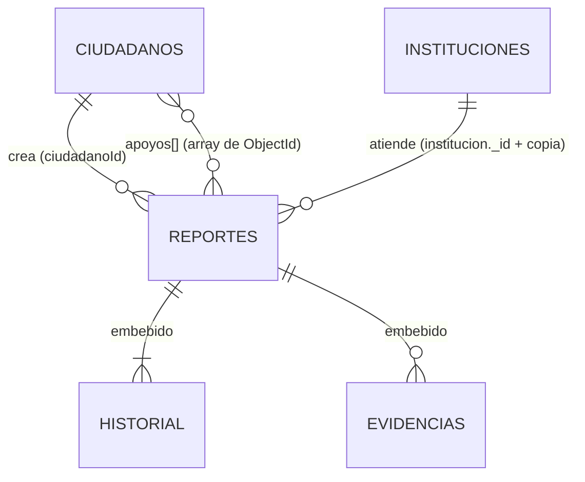

# Diseño del modelo NoSQL: Sistema de Reporte Ciudadano

## 1. Metodología: diseñar desde los casos de uso

En MongoDB el esquema se diseña a partir de **cómo se consultan los datos**, no a partir de las entidades
("Think in Use Cases", clase 10). Estas son las operaciones más frecuentes del sistema:

| # | Caso de uso | Frecuencia | Tipo |
|---|---|---|---|
| 1 | Ver el detalle de un reporte (datos, fotos y bitácora) | Muy alta | Lectura |
| 2 | Listar o filtrar reportes por estado, categoría, municipio, fechas o texto | Muy alta | Lectura |
| 3 | Ver reportes cercanos a mi ubicación | Alta | Lectura geoespacial |
| 4 | Crear un reporte | Media | Escritura |
| 5 | Cambiar el estado de un reporte (institución) | Media | Escritura |
| 6 | Apoyar un reporte ("a mí también me afecta") | Alta | Escritura |
| 7 | Tablero de métricas para autoridades | Baja | Agregación |

El sistema lee mucho más de lo que escribe, y la lectura principal (caso 1) necesita **todo el reporte de una sola vez**.
Por eso el reporte es el documento central y lo que se consulta junto se embebe en él.

## 2. Colecciones



### `reportes` (colección principal)
```json
{
  "_id": ObjectId,
  "folio": "RC-2026-000401",
  "titulo": "Bache profundo frente a escuela",
  "descripcion": "...",
  "categoria": "bache",
  "prioridad": "alta",
  "nivelPrioridad": 3,
  "estado": "en_proceso",
  "ubicacion": { "type": "Point", "coordinates": [-89.1914, 13.6989] },
  "direccion": { "departamento": "San Salvador", "municipio": "San Salvador Centro", "referencia": "..." },
  "ciudadanoId": ObjectId,
  "institucion": { "_id": ObjectId, "codigo": "AM-SAN-SALVADOR-CENTRO", "nombre": "Alcaldía Municipal de ..." },
  "historial": [ { "estado": "recibido", "fecha": ISODate, "actor": "Ana Flores", "comentario": "..." } ],
  "evidencias": [ { "url": "https://...", "tipo": "foto", "fechaSubida": ISODate } ],
  "apoyos": [ ObjectId, ObjectId ],
  "totalApoyos": 2,
  "etiquetas": ["escuela", "peligro"],
  "calificacion": { "puntaje": 4, "comentario": "...", "fecha": ISODate },
  "fechaCreacion": ISODate, "fechaActualizacion": ISODate, "fechaResolucion": ISODate
}
```

### `ciudadanos`
DUI, nombre, correo, teléfono, `direccion` embebida y `estadisticas` precalculadas (`totalReportes`, `ultimoReporte`).

### `instituciones`
Código, nombre, tipo, `categoriasAtendidas` (array) y `cobertura` (`nacional`, `departamentos[]`, `municipios[]`).

### `contadores` (auxiliar)
Un único documento `{_id: "folio_reportes", secuencia: N}` que genera folios legibles y únicos con `$inc` atómico.

## 3. Embeber o referenciar: decisiones y justificación

| Dato | Decisión | Por qué |
|---|---|---|
| `historial` de estados | **Embebido** | Siempre se muestra con el reporte. Es una relación 1:pocos: un flujo normal tiene entre 5 y 7 cambios, con un tope de 50 en el `$jsonSchema`. El cambio de estado y su registro en la bitácora quedan en **una sola operación atómica** (`$set` + `$push`), sin necesidad de transacciones. |
| `evidencias` | **Embebido y acotado (máx. 10)** | Se leen junto con el reporte. Se guardan **URLs**, no archivos binarios, para no acercarse al límite de **16 MB** por documento. El tope se controla en la API (`evidencias.9` + `$exists`) y en el `$jsonSchema` (`maxItems`). |
| `ubicacion` y `direccion` | **Embebido** | Relación 1:1 que se consulta siempre con el reporte. Usa el formato GeoJSON que requiere el índice `2dsphere`. |
| `calificacion` | **Embebido** | Relación 1:1 opcional, que solo existe cuando el reporte está resuelto. |
| Ciudadano autor | **Referencia** (`ciudadanoId`) | El ciudadano existe por su cuenta, tiene datos personales (DUI, teléfono) que **no deben copiarse** en cada reporte y puede crear muchos reportes (1:N sin límite). El detalle del reporte resuelve la referencia y expone solo nombre y municipio. |
| Institución asignada | **Referencia extendida** (`institucion: {_id, codigo, nombre}`) | Los listados muestran el nombre de la institución en cada fila. Copiar solo esos campos evita un `$lookup` en la consulta más frecuente (*Extended Reference Pattern*). El dato duplicado casi no cambia, y cuando cambia el `PATCH /instituciones/{id}` lo sincroniza con `update_many`. |
| `apoyos` | **Array de ObjectId** + `totalApoyos` | Es una relación N:M entre ciudadanos y reportes. Basta guardar los ids para impedir votos duplicados con `$ne`. El contador `totalApoyos` (*Computed Pattern*) permite ordenar e indexar sin calcular `$size`. Si un reporte superara miles de apoyos, se aplicaría el *Outlier Pattern* (moverlos a otra colección). |
| `direccion` del ciudadano | **Embebido** | Relación 1:1. |
| `estadisticas` del ciudadano | **Embebido (Computed Pattern)** | Evita contar los reportes en cada lectura del perfil. Se actualiza con `$inc` al crear o eliminar un reporte, y el seed la recalcula con `$merge`. |

### Patrones de diseño aplicados (clase 10)
- **Extended Reference:** la institución dentro del reporte.
- **Computed:** `totalApoyos`, `nivelPrioridad` y `estadisticas` del ciudadano.
- **Subset:** en los listados se proyectan solo los campos necesarios; `historial`, `apoyos` y `descripcion` quedan fuera.
- **Bounded array:** historial (50) y evidencias (10) tienen tope para respetar el límite de 16 MB.

## 4. Validación con `$jsonSchema`

Las tres colecciones de negocio se crean con `validationLevel: "strict"` y `validationAction: "error"`
(ver [`scripts/init_db.py`](../scripts/init_db.py)). Algunas reglas destacadas:

- **Patrones (regex):** DUI (`^[0-9]{8}-[0-9]$`), teléfono salvadoreño, correo y folio `RC-AAAA-NNNNNN`.
- **Enumeraciones:** categoría, prioridad, estado, tipo de institución y tipo de evidencia.
- **Coordenadas:** deben caer **dentro de El Salvador**. `coordinates` se valida como tupla: longitud entre -90.2 y -87.6, latitud entre 13.1 y 14.5.
- **Arrays:** `minItems`, `maxItems` y `uniqueItems` (no se repiten apoyos ni categorías atendidas).
- **Tipos estrictos:** `objectId` para las referencias, `date` para las fechas, `bool`, `int` o `long`.

El sistema valida en **dos capas**. Pydantic, en la API, devuelve errores claros al cliente. El `$jsonSchema`
protege la base de datos aunque alguien escriba directamente desde mongosh o Compass. Si un documento viola el
esquema, MongoDB responde con el código 121 y la API lo traduce a un HTTP 422.

## 5. Índices

| Colección | Índice | Consulta que apoya |
|---|---|---|
| reportes | `{folio: 1}` único | Búsqueda por folio |
| reportes | `{estado, categoria, fechaCreacion: -1}` | Filtros del listado; sigue la regla ESR (Equality, Sort, Range) |
| reportes | `{direccion.departamento, direccion.municipio, fechaCreacion: -1}` | Reportes de un municipio |
| reportes | `{ciudadanoId, fechaCreacion: -1}` | Historial de un ciudadano |
| reportes | `{institucion._id, estado}` | Bandeja de trabajo de una institución |
| reportes | `{ubicacion: "2dsphere"}` | `$nearSphere` (reportes cercanos) |
| reportes | texto en `titulo` (peso 5), `etiquetas` (3) y `descripcion` (1), idioma español | `$text` |
| ciudadanos | `{dui}` y `{email}` únicos | Evitar registros duplicados |
| instituciones | `{codigo}` único, `{categoriasAtendidas, activa}` | Enrutamiento automático |

## 6. Lógica de negocio que depende del modelo

1. **Enrutamiento automático** ([`servicios.py`](../app/servicios.py)): busca las instituciones activas que atienden
   la categoría y cubren el lugar (`$or` entre municipio, departamento y nacional) y elige la más específica.
   Por ejemplo, un bache en "San Salvador Centro" va a esa alcaldía antes que al MOP.
2. **Máquina de estados:** `recibido → en_revision → asignado → en_proceso → resuelto`. Se puede rechazar en
   las primeras etapas y reabrir un caso resuelto. El cambio usa **concurrencia optimista**: el filtro incluye el
   estado anterior, así que si dos operadores actúan al mismo tiempo solo uno gana.
3. **Apoyos sin duplicados:** `update_one({_id, apoyos: {$ne: cid}, ciudadanoId: {$ne: cid}}, {$push, $inc})`
   lo resuelve en una sola operación atómica, sin leer antes.
4. **Calificación:** solo el autor puede calificar, una sola vez y con el reporte resuelto. Las tres condiciones van en el filtro del update.

## 7. Escalabilidad (sharding)

Si el sistema creciera a nivel nacional con millones de reportes, la clave de fragmentación propuesta sería:

```js
sh.shardCollection("reporte_ciudadano.reportes", { "direccion.departamento": 1, "_id": "hashed" })
```

- `direccion.departamento` como prefijo hace que las consultas por departamento o municipio, que son las más
  comunes, sean **dirigidas** a pocos shards en lugar de *scatter-gather*.
- `_id` hasheado reparte las escrituras de un mismo departamento entre chunks. Así San Salvador, el departamento
  con más reportes, no se convierte en un *hotspot*.
- Se descartó `fechaCreacion` como clave porque es monótona creciente: todas las escrituras irían al último chunk.
