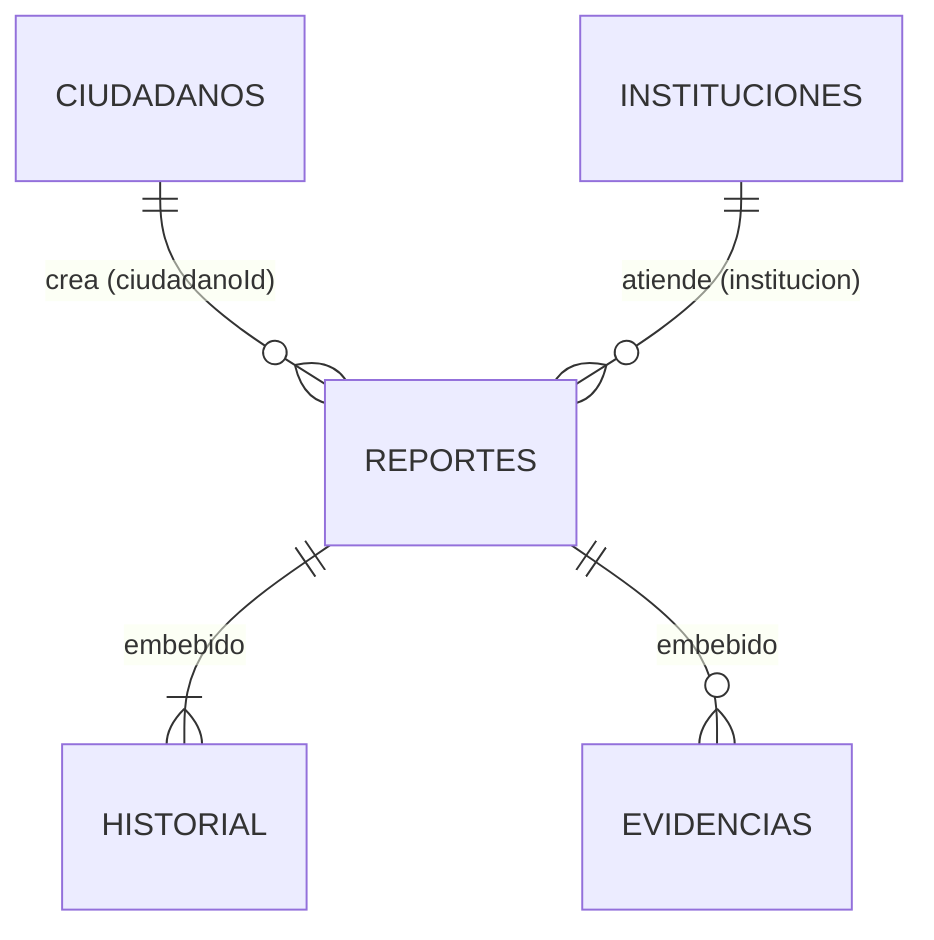

# Diseño del modelo NoSQL: Sistema de Reporte Ciudadano

## 1. ¿Cómo se usan los datos?

En MongoDB el esquema se diseña pensando en **cómo se van a consultar los datos** (clase 10, "Think in Use Cases").
Las operaciones principales del sistema son:

| Operación | Frecuencia |
|---|---|
| Ver el detalle de un reporte (datos, fotos e historial) | Muy alta |
| Listar y filtrar reportes por estado, categoría, municipio o fechas | Muy alta |
| Apoyar un reporte ("a mí también me afecta") | Alta |
| Crear un reporte | Media |
| Cambiar el estado de un reporte (lo hace la institución) | Media |
| Ver métricas para las autoridades | Baja |

Lo que más se hace es **leer un reporte completo**. Por eso el reporte es el documento principal y lo que siempre
se muestra junto con él se guarda **dentro** del mismo documento (embebido).

## 2. Colecciones



### `reportes` (colección principal)
```json
{
  "_id": ObjectId,
  "folio": "RC-2026-000401",
  "titulo": "Bache profundo frente a escuela",
  "descripcion": "...",
  "categoria": "bache",
  "prioridad": "alta",
  "nivelPrioridad": 3,
  "estado": "en_proceso",
  "ubicacion": { "latitud": 13.6989, "longitud": -89.1914 },
  "direccion": { "departamento": "San Salvador", "municipio": "San Salvador Centro", "referencia": "..." },
  "ciudadanoId": ObjectId,
  "institucion": { "_id": ObjectId, "codigo": "AM-SAN-SALVADOR-CENTRO", "nombre": "Alcaldía Municipal de ..." },
  "historial": [ { "estado": "recibido", "fecha": ISODate, "actor": "Ana Flores", "comentario": null } ],
  "evidencias": [ { "url": "https://...", "tipo": "foto", "fechaSubida": ISODate } ],
  "apoyos": [ ObjectId, ObjectId ],
  "totalApoyos": 2,
  "etiquetas": ["escuela", "peligro"],
  "calificacion": { "puntaje": 4, "comentario": null, "fecha": ISODate },
  "fechaCreacion": ISODate, "fechaActualizacion": ISODate, "fechaResolucion": ISODate
}
```

### `ciudadanos`
DUI, nombre, correo, teléfono, `direccion` (embebida) y `estadisticas` (`totalReportes`, `ultimoReporte`).

### `instituciones`
Código, nombre, tipo, `categoriasAtendidas` (array) y `cobertura` (si es nacional, o qué departamentos o municipios atiende).

### `contadores` (auxiliar)
Un solo documento que lleva el último número de folio. Con `$inc` se obtiene el siguiente sin que se repita.

## 3. ¿Qué se embebió y qué se referenció?

| Dato | Decisión | Por qué |
|---|---|---|
| `historial` | **Embebido** | Siempre se muestra con el reporte y son pocos elementos (5 a 7 cambios; el máximo es 50). Al cambiar el estado, un solo `update_one` hace `$set` del estado y `$push` al historial. |
| `evidencias` | **Embebido (máx. 10)** | Se ven junto con el reporte. Se guardan solo **URLs**, no las fotos, para no acercarse al límite de **16 MB** por documento. |
| `ubicacion` y `direccion` | **Embebido** | Relación 1 a 1 que siempre se consulta con el reporte. |
| `calificacion` | **Embebido** | Relación 1 a 1 que solo existe cuando el reporte está resuelto. |
| Ciudadano autor | **Referencia** (`ciudadanoId`) | El ciudadano existe por sí solo, tiene datos personales (DUI, teléfono) que **no se deben copiar** en cada reporte y puede crear muchos reportes (1 a N). |
| Institución | **Referencia extendida** (`_id` + `codigo` + `nombre`) | El listado muestra el nombre de la institución en cada fila. Al copiar solo esos datos no hace falta un `$lookup` cada vez. Si una institución cambia de nombre, el `PATCH /instituciones/{id}` lo actualiza en los reportes con `update_many`. |
| `apoyos` | **Array de ObjectId** + `totalApoyos` | Es una relación N a M. Con los ids se evita que alguien apoye dos veces (`$ne`), y el contador sirve para ordenar sin calcular el tamaño del array. |
| `estadisticas` del ciudadano | **Embebido** | Se guarda el total de reportes con `$inc` para no tener que contarlos cada vez que se ve el perfil. |

### Patrones de diseño (clase 10)
- **Referencia extendida:** la institución dentro del reporte.
- **Valores calculados (Computed):** `totalApoyos`, `nivelPrioridad` y las `estadisticas` del ciudadano.
- **Subconjunto (Subset):** los listados solo traen los campos necesarios (proyección sin `historial`, `apoyos` ni `descripcion`).

## 4. Validación con `$jsonSchema`

Las tres colecciones tienen reglas que MongoDB revisa en cada inserción o actualización
(ver [`scripts/init_db.py`](../scripts/init_db.py)):

- **Campos obligatorios** (`required`).
- **Formatos con regex** (`pattern`): DUI `00000000-0`, teléfono, correo y folio `RC-AAAA-NNNNNN`.
- **Valores permitidos** (`enum`): categoría, prioridad, estado y tipo de institución.
- **Rangos:** la latitud y la longitud deben quedar dentro de El Salvador; la calificación va de 1 a 5.
- **Arrays:** máximo de 10 evidencias, máximo de 50 cambios en el historial y al menos una categoría por institución.
- **Tipos:** `objectId` para las referencias y `date` para las fechas.

Si alguien inserta un documento que no cumple, MongoDB lo rechaza con el error **121** ("Document failed validation").
La API también valida los datos antes de enviarlos, para responder con un mensaje claro.

## 5. Índices

| Colección | Índice | ¿Para qué? |
|---|---|---|
| reportes | `{folio: 1}` único | Buscar por folio; no se repiten |
| reportes | `{estado, categoria, fechaCreacion: -1}` | Filtros más usados del listado, ordenados por fecha |
| reportes | `{direccion.departamento, direccion.municipio}` | Reportes de un lugar |
| reportes | `{ciudadanoId, fechaCreacion: -1}` | Reportes de un ciudadano |
| reportes | `{institucion._id}` | Reportes de una institución |
| ciudadanos | `{dui}` y `{email}` únicos | No permitir registros duplicados |
| instituciones | `{codigo}` único y `{categoriasAtendidas}` | Buscar la institución que atiende cada categoría |

## 6. Reglas de negocio

1. **Asignación automática** ([`servicios.py`](../app/servicios.py)): al crear un reporte se busca primero una
   institución del **municipio** que atienda la categoría; si no hay, una del **departamento**; y si tampoco, una
   **nacional**. Por ejemplo, un bache en "San Salvador Centro" va a esa alcaldía; una fuga de agua va a ANDA.
2. **Flujo de estados:** `recibido → en_revision → asignado → en_proceso → resuelto`. Se puede rechazar al principio y
   reabrir un caso resuelto. Cualquier otro cambio responde 409.
3. **Apoyos sin duplicados:** el `update_one` lleva en el filtro `apoyos: {$ne: id}`; si el ciudadano ya había
   apoyado, el filtro no coincide y no se modifica nada.
4. **Calificación:** solo el autor puede calificar, una sola vez y cuando el reporte está resuelto.

## 7. Escalabilidad (sharding, clase 9)

Si el sistema tuviera millones de reportes a nivel nacional, se fragmentaría la colección `reportes` con esta clave:

```js
sh.shardCollection("reporte_ciudadano.reportes", { "direccion.departamento": 1, "_id": "hashed" })
```

- Como casi todas las consultas filtran por departamento, MongoDB sabe a qué shard ir y no tiene que preguntar a todos.
- El `_id` hasheado reparte los reportes de un mismo departamento. Así San Salvador, que tiene más reportes,
  no se convierte en un *hotspot*.
- No se usó la fecha como clave porque siempre crece, y todas las escrituras irían al mismo shard.
